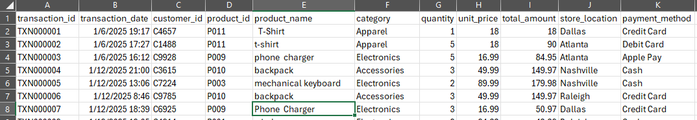
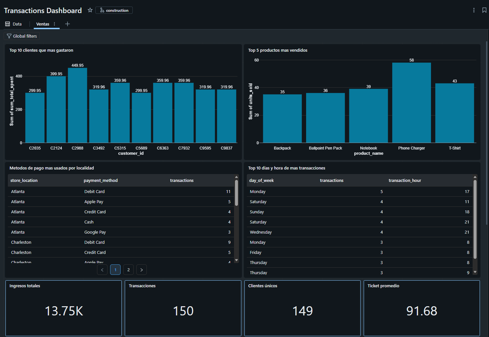

# smartdata-project
Este repositorio contiene mi proyecto final para el curso de SmartData de Ingenieria de Datos e IA con Databricks.

El proyecto trata de obtener data de dos fuentes, una de ellas es del Datalake de Azure y la otra que hace batch ingest programado leyendo archivos de Google Drive; el contenido de estos archivos es combinado para que luego se aplique la parte de transformacion donde se limpia y da formato a los datos.

Luego de la transformacion, se elaboran tablas que sirven como base para la elaboracion de graficas y metricas para el tablero (dashboard).

Los datos utilizados son de transacciones hechas en distintos estados de U.S.A., por ejemplo:

Se puede ver que las 2 primeras compras tienen un product name (columna E) de T-shirt pero estan escritas de distinta manera y hasta se tienen espacios de mas; durante la capa de Silver se aplican las transformaciones correspondientes como se menciono anteriormente.

